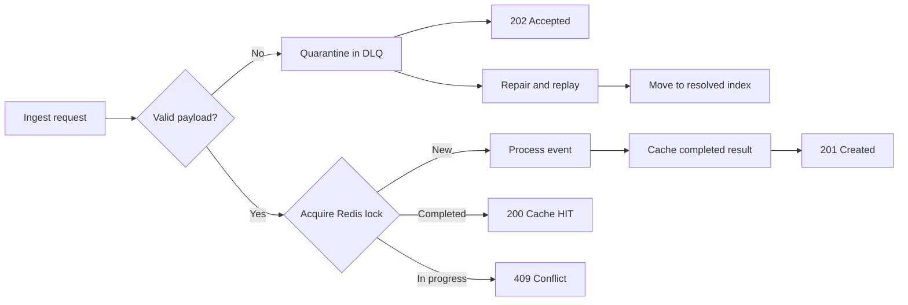

# Resilient Ingestion Engine

An asynchronous FastAPI service for safely ingesting ticket events. Redis
provides idempotency, duplicate-request protection, response caching, and a
dead-letter queue (DLQ) for invalid payloads.

## How it works



The ingestion flow provides:

- Atomic Redis locks to prevent concurrent duplicate processing
- A two-minute lock for requests currently in progress
- Completed-response caching for 24 hours
- Automatic idempotency keys based on tenant and event IDs
- Quarantine of malformed JSON and schema-invalid payloads
- DLQ retry tracking, including the last error and retry timestamp
- Repair and replay of quarantined payloads
- Persistent Redis storage through a Docker volume

## Project structure

```text
.
├── config/
│   └── redis.py                    # FastAPI lifespan and Redis lifecycle
├── dlq/
│   ├── models.py                   # Persisted DLQ record
│   ├── router.py                   # DLQ list and replay endpoints
│   ├── schemas.py                  # DLQ API schemas
│   └── service.py                  # DLQ persistence and state transitions
├── domain/
│   ├── domain.py                   # Domain errors and ingestion result
│   └── process_ticket_ingestion.py # Idempotent ingestion use case
├── constents.py                    # Lock and cache TTL values
├── docker-compose.yml              # Local Redis service
├── main.py                         # FastAPI application and ingest route
├── redis_client.py                 # Shared async Redis manager
├── requirements.txt
└── schema.py                       # Ticket payload schema
```

## Requirements

- Python 3.11 or newer
- Docker with Docker Compose

## Local setup

Create a virtual environment and install the dependencies:

```bash
python3 -m venv .venv
source .venv/bin/activate
pip install -r requirements.txt
```

Start Redis:

```bash
docker compose up -d redis
```

Start the API:

```bash
uvicorn main:app --reload
```

The API is available at `http://localhost:8000`. OpenAPI documentation is
available at `http://localhost:8000/docs`.

Stop Redis without deleting its data:

```bash
docker compose down
```

## API reference

### Health check

```http
GET /healthz
```

Example response:

```json
{
  "status": "ok",
  "redis_connected": true
}
```

### Ingest a ticket event

```http
POST /api/v1/ingest
```

Optional headers:

- `Idempotency-Key`: caller-provided request key
- `X-Tenant-ID`: tenant hint retained when an invalid payload is quarantined

If `Idempotency-Key` is omitted, the service derives one from `tenant_id` and
`event_id`.

```bash
curl -i -X POST http://localhost:8000/api/v1/ingest \
  -H "Content-Type: application/json" \
  -H "Idempotency-Key: request-001" \
  -d '{
    "event_id": "evt_1001",
    "tenant_id": "org_corp_42",
    "event_type": "ticket.created",
    "timestamp": "2026-10-12T01:50:00Z",
    "data": {
      "ticket_id": "TCK-1049",
      "priority": "P2"
    }
  }'
```

Supported event types:

- `ticket.created`
- `ticket.updated`
- `ticket.resolved`

Responses:

| Status | Meaning |
| --- | --- |
| `201 Created` | New event accepted; includes `X-Cache: MISS` |
| `200 OK` | Completed duplicate returned from cache; includes `X-Cache: HIT` |
| `202 Accepted` | Invalid payload quarantined in the DLQ |
| `409 Conflict` | Another request with the same key is still processing |
| `500 Internal Server Error` | Downstream processing failed |

### List unresolved DLQ records

```http
GET /api/v1/dlq?limit=20
```

`limit` accepts values from 1 through 100. Records are returned newest first.

### Replay a DLQ record

To retry the original payload:

```bash
curl -i -X POST \
  http://localhost:8000/api/v1/dlq/{quarantine_id}/replay \
  -H "Content-Type: application/json" \
  -d '{}'
```

To repair the payload before replaying it:

```bash
curl -i -X POST \
  http://localhost:8000/api/v1/dlq/{quarantine_id}/replay \
  -H "Content-Type: application/json" \
  -d '{
    "repaired_payload": {
      "event_id": "evt_1001",
      "tenant_id": "org_corp_42",
      "event_type": "ticket.created",
      "timestamp": "2026-10-12T01:50:00Z",
      "data": {}
    }
  }'
```

Replay responses:

| Status | Meaning |
| --- | --- |
| `200 OK` | Payload processed and moved to the resolved DLQ index |
| `404 Not Found` | Quarantine record does not exist |
| `422 Unprocessable Entity` | Original or repaired payload remains invalid |
| `500 Internal Server Error` | Replay execution failed |

Failed replay attempts increment `retry_count` and update `last_retry_at` and
`last_replay_error`. A successful replay records `resolved_at` and moves the
record from `dlq:index:unresolved` to `dlq:index:resolved`.

## Redis keys

| Key | Purpose |
| --- | --- |
| `idempotency:{key}` | In-progress lock or completed ingestion response |
| `dlq:record:{id}` | Serialized quarantined payload and replay history |
| `dlq:index:unresolved` | Sorted index of unresolved DLQ records |
| `dlq:index:resolved` | Sorted index of successfully replayed records |
